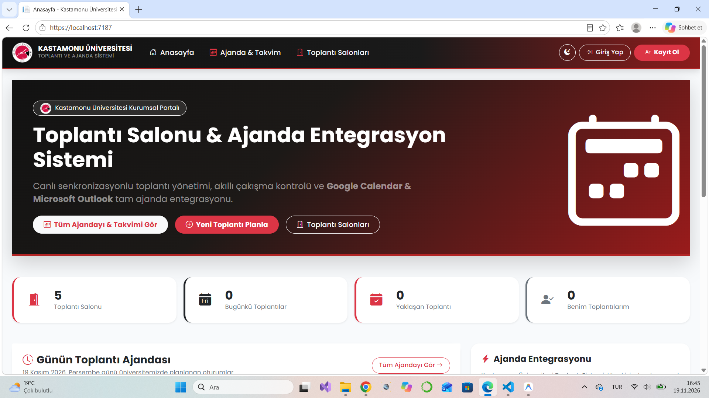
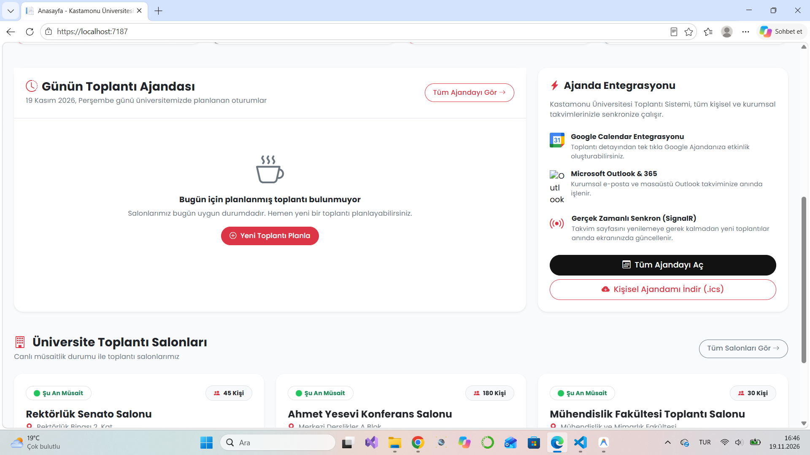
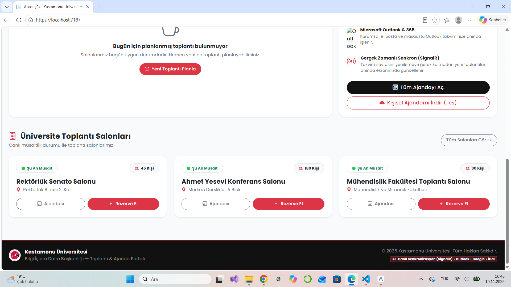
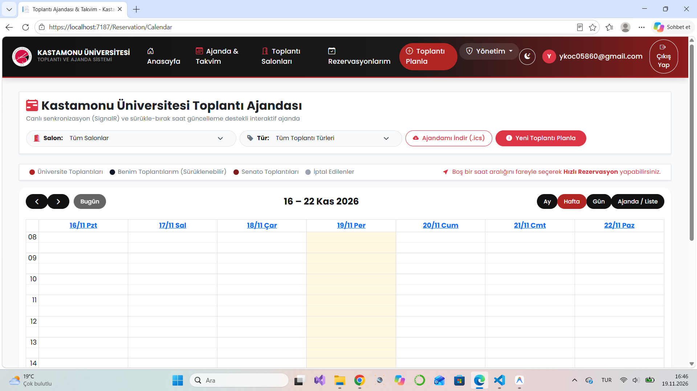
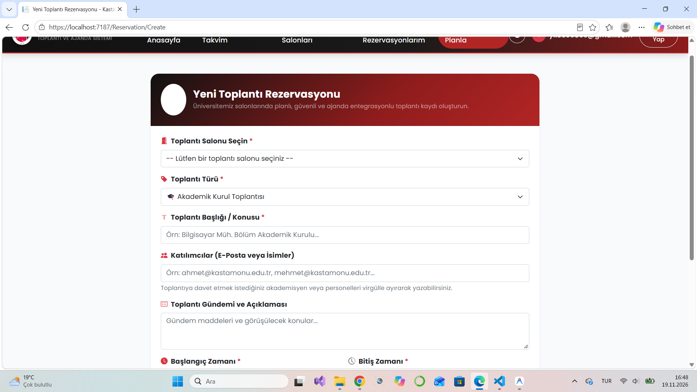
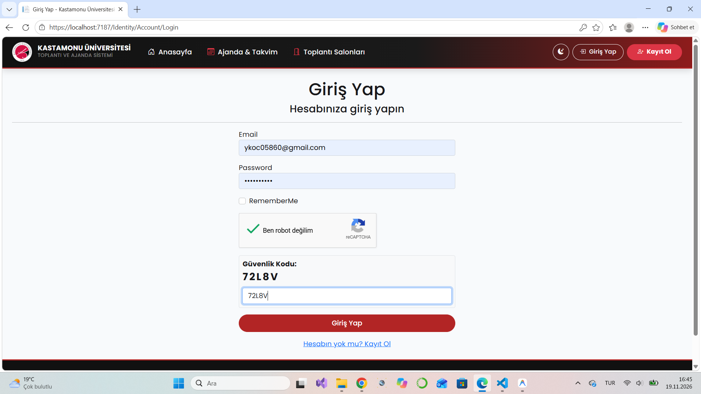
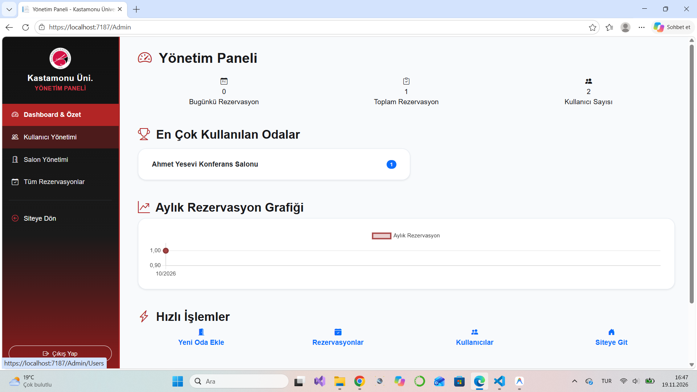

<div align="center">

# 🏛️ Kastamonu Üniversitesi — Toplantı & Ajanda Yönetim Sistemi
### *Kastamonu University — Meeting Room & Academic Agenda Management System*

[](https://dotnet.microsoft.com/)
[](https://dotnet.microsoft.com/apps/aspnet)
[](https://dotnet.microsoft.com/apps/aspnet/signalr)
[](https://learn.microsoft.com/ef/core/)
[](https://getbootstrap.com/)
[](LICENSE)

<br/>

**[🇹🇷 Türkçe Dokümantasyon](#-türkçe-dokümantasyon)** &nbsp;|&nbsp; **[🇬🇧 English Documentation](#-english-documentation)**

<br/>



</div>

---

# 🇹🇷 Türkçe Dokümantasyon

## 📖 Proje Hakkında
**Kastamonu Üniversitesi Toplantı ve Ajanda Yönetim Sistemi**, üniversite bünyesindeki rektörlük birimleri, fakülteler ve enstitülere ait toplantı ve konferans salonlarının rezervasyonlarını, akademik etkinlik ajandasını, salon doluluk durumlarını ve kapı tablet ekranlarını (Kiosk) tek merkezden yönetmek amacıyla geliştirilmiş yeni nesil, gerçek zamanlı kurumsal bir web platformudur.

Proje, Kastamonu Üniversitesi kurumsal renk kimliğine (Bordo-Kırmızı, Siyah ve Beyaz) tam uyumlu olarak tasarlanmış olup, zenginleştirilmiş kullanıcı deneyimi (UI/UX), Koyu/Açık Tema desteği, ASP.NET Core SignalR ile canlı takvim senkronizasyonu ve mobil uyumlu Kiosk kapı ekranı yeteneklerini bir arada sunar.

---

## 📸 Ekran Görüntüleri ve Arayüz Galerisi

### 1. Anasayfa & Kurumsal Ä°statistik Paneli
Kullanıcıları karşılayan kurumsal karşılama alanı, toplam salon sayısı, bugünkü toplantılar ve yaklaşan etkinlik sayaçları.
<p align="center">
  
</p>

### 2. Günün Toplantı Ajandası & Takvim Entegrasyonları
Günün planı, Google Calendar ve Outlook entegrasyon kartları ve iCal (.ics) indirme bağlantıları.
<p align="center">
  
</p>

### 3. Canlı Salon Durum Göstergesi (Pulse Badges)
Her salonda o an toplantı olup olmadığını gösteren canlı nabız göstergesi (`🟢 Şu An Müsait` veya `🔴 Toplantı Sürüyor` ve kalan süre bildirimi).
<p align="center">
  
</p>

### 4. İnteraktif Toplantı Takvimi (FullCalendar & SignalR)
Sayfa yenilemeden canlı senkronize olan, salon ve akademik toplantı türüne göre filtrelenebilen, sürükle-bırak destekli ajanda.
<p align="center">
  
</p>

### 5. Yeni Toplantı Rezervasyon Formu
Akademik toplantı türü seçimi (Senato, Akademik Kurul, Tez Savunması, BAP), katılımcı davet listesi ve gündem açıklamaları girişi.
<p align="center">
  
</p>

### 6. Kullanıcı Rezervasyonlarım Listesi & ICS İndirme
Kullanıcının aktif ve geçmiş toplantılarını takip edebildiği, tek tıkla dijital takvim dosyası (.ics) indirebildiği ve detay tutanağına ulaşabildiği yönetim alanı.
<p align="center">
  
</p>

### 7. Güvenli Giriş, reCAPTCHA & Grafik Güvenlik Kodu (Captcha)
Google reCAPTCHA ve dinamik çizilen güvenlik koduyla brute-force ve bot ataklarına karşı korumalı oturum açma sayfası.
<p align="center">
  
</p>

### 8. Yönetim Paneli — Dashboard & Aylık Rezervasyon Analitiği
Yöneticiler için anlık istatistikler, en çok kullanılan salon sıralaması ve Chart.js destekli aylık rezervasyon trend grafiği.
<p align="center">
  
</p>

### 9. Yönetim Paneli — Kullanıcı ve Rol Yönetimi
Sistemdeki kullanıcıları listeleme, detaylarını inceleme ve tek tıkla Admin / User rol ataması yapabilme ekranı.
<p align="center">
  
  
</p>

### 10. Yönetim Paneli — Tüm Rezervasyonların Denetimi
Üniversite genelinde açılan tüm toplantıları onaylama, detaylarını görme, gerektiğinde iptal etme veya silme ekranı.
<p align="center">
  
</p>

---

## 🌟 Öne Çıkan Fonksiyonel Özellikler

- **🏛️ Kurumsal Renk Paleti:** Kastamonu Üniversitesi'nin kurumsal kimliği olan `#B22525` Bordo-Kırmızı, `#111111` Siyah ve `#FFFFFF` Beyaz uyumu.
- **🌓 Koyu / Açık Mod (Dark & Light Theme):** Tek tıkla gece moduna geçiş; tercih `localStorage` hafızasında tutulur.
- **🟢 Canlı Salon Durum Rozetleri:** Anlık müsaitlik tespiti, devam eden toplantı adı ve kalan süre sayacı.
- **🔄 SignalR ile Canlı Senkronizasyon:** Farklı bir kullanıcının eklediği veya güncellediği toplantı, açık olan tüm takvimlerde sayfa yenilenmeden anında belirir.
- **🖱️ Sürükle & Bırak ile Saat Güncelleme:** FullCalendar üzerinden toplantı kutusu fareyle sürüklenerek saati değiştirilebilir; çakışma durumunda işlem otomatik geri alınır.
- **⚡ 5 Saniyede Hızlı Rezervasyon:** Takvimde boş bir aralık taranarak sayfa değiştirmeden modal penceresinden hızlı kayıt açılabilir.
- **📺 Salon Kapı Ekranı / Kiosk Tablet Modu (`/Room/DoorDisplay/{id}`):** Salon kapısına asılan tabletler için büyük saat, durum rengi parlaması ve salona özel dinamik QR kod.
- **🎓 Akademik Toplantı Türleri:** Senato Toplantısı, Fakülte/Bölüm Kurulu, Tez Savunması, BAP Toplantısı, Öğrenci Kulübü ve Konferans/Seminer kategorileri.
- **📅 Ajanda & Takvim Entegrasyonu:** Google Calendar, Apple Calendar ve Microsoft Outlook (.ics) tam uyumluluğu.
- **📄 Resmi Tutanak ve Çağrı Çıktısı:** Tek tıkla resmi üniversite formatında katılım yoklama tutanağı yazdırma (`window.print()`).

---

<br/><br/>

# 🇬🇧 English Documentation

## 📖 About The Project
**Kastamonu University Meeting Room & Academic Agenda Management System** is an enterprise-grade, real-time web platform built to manage conference rooms, academic board meetings, real-time room occupancy, and smart door tablet kiosk displays across university faculties and departments.

Built with **ASP.NET Core 8 MVC**, **SignalR**, and **Entity Framework Core**, it provides a corporate Red-Black-White aesthetic matching Kastamonu University's brand guidelines, featuring complete Dark/Light mode support, live calendar synchronization, drag-and-drop scheduling, and printable official attendance minutes.

---

## 🚀 Key Features

- **🏛️ University Identity & Responsive Design:** Elegant Red (`#B22525`), Black (`#111111`), and White (`#FFFFFF`) color scheme.
- **🌓 Dark / Light Mode Toggle:** Smooth CSS-variable driven theme switching persisted in `localStorage`.
- **🟢 Live Room Occupancy Badges:** Real-time pulse indicator showing whether a room is currently available (`🟢 Available`) or occupied (`🔴 Meeting in Progress` with remaining minutes).
- **🔄 Real-Time SignalR Synchronization:** Instant cross-client calendar updates upon reservation creation, modification, or cancellation without page reloads.
- **🖱️ FullCalendar Drag-and-Drop & Slot Booking:** Drag-and-drop rescheduling with automatic backend conflict validation, plus 5-second quick modal booking.
- **📺 Door Display / Kiosk Tablet Mode (`/Room/DoorDisplay/{id}`):** Designed for tablet displays mounted outside meeting rooms; features a live digital clock, status glow, meeting progress bar, and dynamic QR code.
- **🎓 Academic Categorization:** Dedicated categories for Senate Meetings, Faculty Boards, Thesis Defenses, Research Projects (BAP), Student Clubs, and Seminars.
- **📅 Universal Calendar Integration:** 1-click Google Calendar add-link, Microsoft Outlook / Office 365, and RFC 5545 iCalendar (`.ics`) file export.
- **🛡️ Enterprise Security:** ASP.NET Core Identity with Cookie security, Role-Based Access Control (Admin/User), Google reCAPTCHA v2/v3, and dynamic graphical captcha.
- **📄 Printable Minutes of Meeting:** Formatted university attendance sheet ready for signing and printing (`window.print()`).

---

## 🛠️ Tech Stack

| Layer | Technology | Purpose |
| :--- | :--- | :--- |
| **Backend Framework** | .NET 8.0 / C# 12 | Enterprise-grade, high-performance MVC foundation |
| **Architecture** | ASP.NET Core MVC | Model-View-Controller + Modular Areas (Admin) |
| **Real-Time Engine** | ASP.NET Core SignalR | WebSocket-based bidirectional live calendar synchronization |
| **Database & ORM** | Entity Framework Core 8/9 + MS SQL Server | Code-First, Connection Resiliency, Automatic Schema Patching |
| **Security & Auth** | ASP.NET Core Identity | Cookie hardening, Password Hashing, RBAC (Admin / User) |
| **Frontend UI** | Bootstrap 5.3 + Custom CSS3 | University Palette, CSS Variables, Responsive Layout |
| **Calendar Engine** | FullCalendar v6 | DayGrid, TimeGrid, Interaction (Drag/Drop/Select) |
| **Libraries & Plugins** | SweetAlert2, FontAwesome 6, QRious.js, iCal.NET | Dynamic alerts, vector icons, dynamic QR codes, ICS generator |

---

## 📁 Project Structure

```bash
UniversityMeetingSystem/
│
├── Areas/
│   └── Admin/                     # Admin Portal (Dashboard, Room & User Management)
│       ├── Controllers/
│       └── Views/
│
├── Controllers/
│   ├── HomeController.cs          # Public dashboard, live occupancy stats & today's agenda
│   ├── ReservationController.cs   # Booking workflow, FullCalendar API, SignalR & ICS export
│   └── RoomController.cs          # Room directory, equipment filtering & Kiosk Door Display
│
├── Data/
│   └── ApplicationDbContext.cs    # EF Core database context & relationships
│
├── Hubs/
│   └── CalendarHub.cs             # Real-time SignalR event broadcast hub
│
├── Models/
│   ├── ApplicationUser.cs         # Extended Identity user model
│   ├── Reservation.cs             # Booking model (MeetingType, Attendees, Schedule)
│   ├── Room.cs                    # Room model (Amenities, Department, Live Status)
│   └── HomeDashboardViewModel.cs  # Unified view model for the home dashboard
│
├── Services/
│   ├── CalendarIntegrationService.cs  # RFC 5545 iCalendar (.ics) & Google Calendar generator
│   └── SmtpEmailSender.cs             # Email invitation and notification service
│
├── Views/
│   ├── Home/                      # Landing page, statistics & live room cards
│   ├── Reservation/               # Interactive calendar, details, printable sign sheet
│   ├── Room/                      # Room catalog, amenity badges, and Kiosk DoorDisplay
│   └── Shared/                    # Navigation bar, Dark Mode switcher, SignalR listener
│
├── screenshots/                   # High-resolution screenshots showcasing the project
├── wwwroot/
│   ├── css/site.css               # Corporate Red-White-Black theme & Dark Mode styles
│   └── js/site.js                 # SignalR client listener & theme persistence
│
├── Program.cs                     # Service registrations, SignalR hub routing, Seed Data
└── README.md                      # Comprehensive dual-language documentation
```

---

## 🚀 Quick Start & Installation

### Prerequisites
- [.NET 8.0 SDK](https://dotnet.microsoft.com/download/dotnet/8.0)
- [Microsoft SQL Server](https://www.microsoft.com/sql-server/) (or SQL Server Express / LocalDB)
- [Visual Studio 2022](https://visualstudio.microsoft.com/) or [VS Code](https://code.visualstudio.com/)

### 1. Clone the Repository
```bash
git clone https://github.com/YusufKoc05/UniversityMeetingSystem.git
cd UniversityMeetingSystem/KastamonuMeetingRoom/KastamonuMeetingRoom
```

### 2. Configure Database Connection
Open `appsettings.json` and adjust the connection string to match your local SQL Server instance:
```json
"ConnectionStrings": {
  "DefaultConnection": "Server=localhost\\SQLEXPRESS;Database=MeetingRoomDB;Trusted_Connection=True;MultipleActiveResultSets=true;TrustServerCertificate=True"
}
```

### 3. Run the Application
The application will automatically perform schema migration and seed initial meeting rooms along with the default administrator account:
```bash
dotnet run
```
Or press **`F5`** inside Visual Studio / VS Code.

Navigate to:
- **Web App:** `https://localhost:7187` or `http://localhost:5044`

---

## 🔑 Default Administrator Credentials

Upon initial launch, the system automatically creates the admin account:
- **Email:** `admin@kastamonu.com`
- **Password:** `Admin123!`

---

## 📺 Kiosk / Tablet Door Display Route

Mount a tablet outside each conference hall and navigate to:
```text
https://localhost:7187/Room/DoorDisplay/{RoomId}
```
*Examples:*
- **Senate Hall Kiosk:** `/Room/DoorDisplay/1`
- **Ahmet Yesevi Hall Kiosk:** `/Room/DoorDisplay/2`

> **Note:** The dynamic QR code on the kiosk screen allows passersby to scan with their mobile devices to instantly view the room's live schedule on their phones.

---

## 📄 License
This project is licensed under the [MIT License](LICENSE). You are free to adapt and customize it for educational or institutional use.

---

## 👨‍💻 Developer & Contact

**Yusuf Koç**  
- **GitHub:** [@YusufKoc05](https://github.com/YusufKoc05)  
- **Repository:** [UniversityMeetingSystem](https://github.com/YusufKoc05/UniversityMeetingSystem)

<div align="center">
  <sub>Developed for Kastamonu University Department of Information Technology & Academic Units.</sub>
</div>

