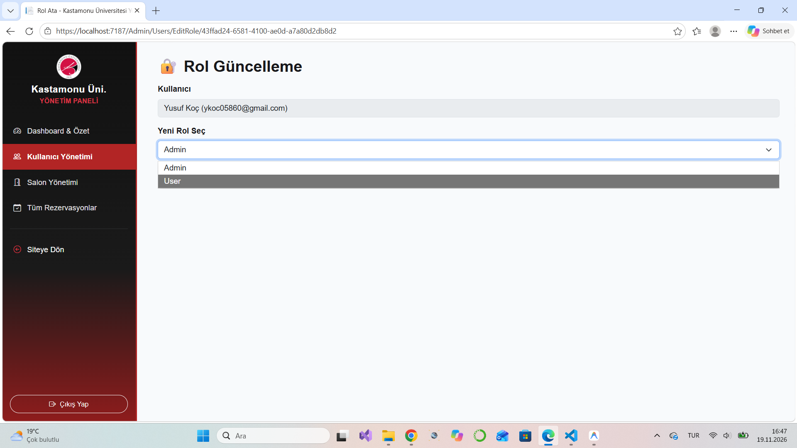

<div align="center">

# 🏛️ University Meeting & Academic Agenda System
### *Kastamonu University — Enterprise Meeting Room & Calendar Management Platform*

[](https://dotnet.microsoft.com/)
[](https://dotnet.microsoft.com/apps/aspnet)
[](https://dotnet.microsoft.com/apps/aspnet/signalr)
[](https://learn.microsoft.com/ef/core/)
[](https://getbootstrap.com/)
[](LICENSE)

<br/>

**🇬🇧 English Documentation** &nbsp;|&nbsp; **[🇹🇷 Türkçe Dokümantasyon (README_TR.md)](README_TR.md)**

<br/>


</div>

---

## 📖 About The Project

**University Meeting & Academic Agenda System** is an enterprise-grade, real-time web platform built to manage meeting rooms, academic board conferences, real-time room occupancy, and smart door tablet kiosk displays across Kastamonu University faculties and administrative units.

Built with **ASP.NET Core 8 MVC**, **SignalR**, and **Entity Framework Core**, it strictly adheres to Kastamonu University corporate brand guidelines (`#B22525` Burgundy-Red, `#111111` Black, and `#FFFFFF` White), featuring complete Dark/Light mode support, live calendar synchronization, drag-and-drop scheduling, dynamic QR codes, and printable official attendance minutes.

---

## 📸 Visual Showcase & Screenshots

### 1. Home Dashboard & University Statistics
Modern greeting hero with live statistics counters (total meeting rooms, today's meetings, upcoming events).
<p align="center">
  
</p>

### 2. Today's Agenda & Calendar Sync
Overview of the current day's scheduled events, Google Calendar & Microsoft Outlook synchronization cards, and `.ics` download buttons.
<p align="center">
  
</p>

### 3. Live Room Occupancy Cards (Pulse Badges)
Real-time pulse indicators showing whether a room is currently available (`🟢 Available`) or occupied (`🔴 Meeting in Progress` with remaining minutes and meeting topic).
<p align="center">
  
</p>

### 4. Interactive FullCalendar & Real-Time SignalR Sync
Interactive calendar with multi-view options (Month, Week, Day, List), room and academic meeting type filters, and real-time updates via SignalR.
<p align="center">
  
</p>

### 5. New Meeting Reservation Form
Comprehensive booking form featuring academic meeting types (Senate, Academic Board, Thesis Defense, Research Projects), attendee email invitations, and agenda notes.
<p align="center">
  
</p>

### 6. User Reservations List & Digital Calendar Export
Personal meeting management table with status tracking, 1-click RFC 5545 `.ics` export, and printable official minutes.
<p align="center">
  
</p>

### 7. Secure Login, reCAPTCHA & Dynamic Graphical Captcha
Hardened authentication screen protected against brute-force attacks via Google reCAPTCHA and custom distorted graphical security codes.
<p align="center">
  
</p>

### 8. Admin Portal — Dashboard & Monthly Analytics
Centralized admin dashboard displaying live counters, most utilized halls, and monthly reservation trend chart.
<p align="center">
  
</p>

### 9. Admin Portal — User & Role Management
User directory and 1-click role assignment (Admin / User) with fine-grained access control.
<p align="center">
  
  
</p>

### 10. Admin Portal — Reservation Oversight
Administrative view of all campus reservations with options to inspect, cancel, or delete bookings.
<p align="center">
  
</p>

---

## 🚀 Key Features

- **🏛️ Corporate University Theme:** Tailored for Kastamonu University using `#B22525` Burgundy-Red, `#111111` Black, and `#FFFFFF` White.
- **🌓 Dark / Light Theme Toggle:** Seamless theme switcher with client-side persistence via `localStorage`.
- **🟢 Live Occupancy Indicators:** Instant room status detection with animated pulse badges and live countdowns.
- **🔄 Real-Time SignalR Synchronization:** Multi-client instant calendar refresh upon meeting creation, update, or deletion.
- **🖱️ Drag-and-Drop & Slot Selection:** FullCalendar drag-and-drop rescheduling with backend conflict validation and 5-second quick booking modal.
- **📺 Tablet / Kiosk Door Display Mode (`/Room/DoorDisplay/{id}`):** Fullscreen display for tablets outside meeting halls with digital clock, status glow, and dynamic QR code.
- **🎓 Academic Categorization:** Color-coded categories for Senate Meetings, Faculty Boards, Thesis Defenses, BAP Projects, Student Clubs, and Conferences.
- **📅 Universal Calendar Integration:** Google Calendar deep-links, Outlook integration, and RFC 5545 iCalendar (`.ics`) file generator.
- **📄 Printable Minutes of Meeting:** Formatted official attendance and decision sheet ready for printing (`window.print()`).
- **🛡️ Enterprise Security:** ASP.NET Core Identity, cookie hardening, rate limiting, Google reCAPTCHA, and graphical captcha.

---

## 🛠️ Tech Stack

| Layer | Technology | Purpose |
| :--- | :--- | :--- |
| **Backend Framework** | .NET 8.0 / C# 12 | Enterprise-grade, high-performance MVC foundation |
| **Architecture** | ASP.NET Core MVC | Model-View-Controller + Modular Admin Area |
| **Real-Time Engine** | ASP.NET Core SignalR | Bidirectional WebSocket communication for live updates |
| **Database & ORM** | Entity Framework Core 8/9 + MS SQL Server | Code-First, Connection Resiliency, Automatic Schema Patching |
| **Security & Auth** | ASP.NET Core Identity | Cookie protection, Password Hashing, RBAC (Admin / User) |
| **Frontend UI** | Bootstrap 5.3 + Custom CSS3 | University corporate palette, CSS variables, Dark Mode |
| **Calendar Engine** | FullCalendar v6 | DayGrid, TimeGrid, Interaction (Drag/Drop/Select) |
| **Libraries & Plugins** | SweetAlert2, FontAwesome 6, QRious.js, iCal.NET | Alerts, vector icons, dynamic QR codes, ICS generator |

---

## 📁 Project Structure

```bash
UniversityMeetingSystem/
│
├── Areas/
│   └── Admin/                     # Admin Portal (Dashboard, Room & User Management)
│       ├── Controllers/
│       └── Views/
│
├── Controllers/
│   ├── HomeController.cs          # Public dashboard, live occupancy stats & today's agenda
│   ├── ReservationController.cs   # Booking workflow, FullCalendar API, SignalR & ICS export
│   └── RoomController.cs          # Room directory, equipment filtering & Kiosk Door Display
│
├── Data/
│   └── ApplicationDbContext.cs    # EF Core database context & relationships
│
├── Hubs/
│   └── CalendarHub.cs             # Real-time SignalR event broadcast hub
│
├── Models/
│   ├── ApplicationUser.cs         # Extended Identity user model
│   ├── Reservation.cs             # Booking model (MeetingType, Attendees, Schedule)
│   ├── Room.cs                    # Room model (Amenities, Department, Live Status)
│   └── HomeDashboardViewModel.cs  # Unified view model for the home dashboard
│
├── Services/
│   ├── CalendarIntegrationService.cs  # RFC 5545 iCalendar (.ics) & Google Calendar generator
│   └── SmtpEmailSender.cs             # Email invitation and notification service
│
├── Views/
│   ├── Home/                      # Landing page, statistics & live room cards
│   ├── Reservation/               # Interactive calendar, details, printable sign sheet
│   ├── Room/                      # Room catalog, amenity badges, and Kiosk DoorDisplay
│   └── Shared/                    # Navigation bar, Dark Mode switcher, SignalR listener
│
├── screenshots/                   # High-resolution screenshots showcasing the project
├── wwwroot/
│   ├── css/site.css               # Corporate Red-White-Black theme & Dark Mode styles
│   └── js/site.js                 # SignalR client listener & theme persistence
│
├── Program.cs                     # Service registrations, SignalR hub routing, Seed Data
├── README.md                      # English documentation
└── README_TR.md                   # Turkish documentation
```

---

## 🚀 Quick Start & Installation

### Prerequisites
- [.NET 8.0 SDK](https://dotnet.microsoft.com/download/dotnet/8.0)
- [Microsoft SQL Server](https://www.microsoft.com/sql-server/) (or SQL Server Express / LocalDB)
- [Visual Studio 2022](https://visualstudio.microsoft.com/) or [VS Code](https://code.visualstudio.com/)

### 1. Clone the Repository
```bash
git clone https://github.com/YusufKoc05/UniversityMeetingSystem.git
cd UniversityMeetingSystem/KastamonuMeetingRoom/KastamonuMeetingRoom
```

### 2. Configure Database Connection
Open `appsettings.json` and adjust the connection string to match your local SQL Server instance:
```json
"ConnectionStrings": {
  "DefaultConnection": "Server=localhost\\SQLEXPRESS;Database=MeetingRoomDB;Trusted_Connection=True;MultipleActiveResultSets=true;TrustServerCertificate=True"
}
```

### 3. Run the Application
The application will automatically perform schema migration and seed initial meeting rooms along with the default administrator account:
```bash
dotnet run
```
Or press **`F5`** inside Visual Studio / VS Code.

Navigate to:
- **Web App:** `https://localhost:7187` or `http://localhost:5044`

---

## 🔑 Default Administrator Credentials

Upon initial launch, the system automatically creates the admin account:
- **Email:** `admin@kastamonu.com`
- **Password:** `Admin123!`

---

## 📺 Kiosk / Tablet Door Display Route

Mount a tablet outside each conference hall and navigate to:
```text
https://localhost:7187/Room/DoorDisplay/{RoomId}
```
*Examples:*
- **Senate Hall Kiosk:** `/Room/DoorDisplay/1`
- **Ahmet Yesevi Hall Kiosk:** `/Room/DoorDisplay/2`

> **Note:** The dynamic QR code on the kiosk screen allows passersby to scan with their mobile devices to instantly view the room's live schedule on their phones.

---

## 📄 License
This project is licensed under the [MIT License](LICENSE). You are free to adapt and customize it for educational or institutional use.

---

## 👨‍💻 Developer & Contact

**Yusuf Koç**  
- **GitHub:** [@YusufKoc05](https://github.com/YusufKoc05)  
- **Repository:** [UniversityMeetingSystem](https://github.com/YusufKoc05/UniversityMeetingSystem)

<div align="center">
  <sub>Developed for Kastamonu University Department of Information Technology & Academic Units.</sub>
</div>
