<div align="center">

# 🏛️ Kastamonu Üniversitesi — Toplantı & Ajanda Yönetim Sistemi
### *Kurumsal Toplantı Salonu, Canlı Ajanda ve Kiosk/Tablet Yönetim Platformu*

[](https://dotnet.microsoft.com/)
[](https://dotnet.microsoft.com/apps/aspnet)
[](https://dotnet.microsoft.com/apps/aspnet/signalr)
[](https://learn.microsoft.com/ef/core/)
[](https://getbootstrap.com/)
[](LICENSE)

<br/>

**🇹🇷 Türkçe Dokümantasyon** &nbsp;|&nbsp; **[🇬🇧 English Documentation (README.md)](README.md)**

<br/>

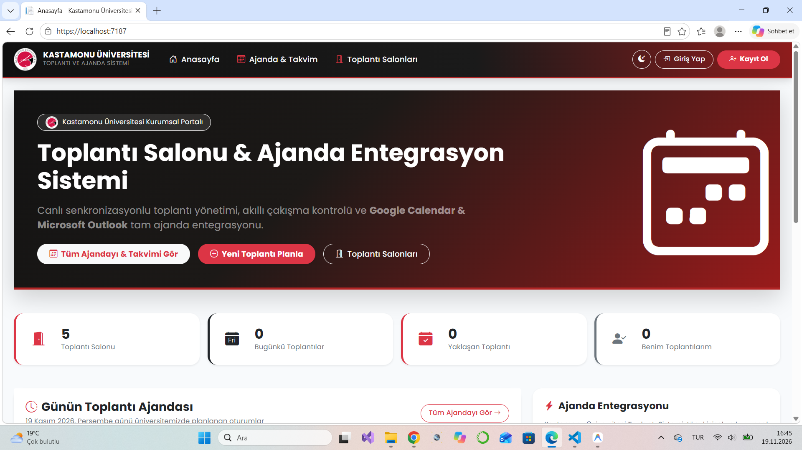

</div>

---

## 📖 Proje Hakkında

**Kastamonu Üniversitesi Toplantı ve Ajanda Yönetim Sistemi**, üniversite bünyesindeki rektörlük birimleri, fakülteler ve enstitülere ait toplantı ve konferans salonlarının rezervasyonlarını, akademik etkinlik ajandasını, salon doluluk durumlarını ve kapı tablet ekranlarını (Kiosk) tek merkezden yönetmek amacıyla geliştirilmiş yeni nesil, gerçek zamanlı kurumsal bir web platformudur.

Proje, Kastamonu Üniversitesi kurumsal renk kimliğine (Bordo-Kırmızı `#B22525`, Siyah `#111111` ve Beyaz `#FFFFFF`) tam uyumlu olarak tasarlanmış olup, zenginleştirilmiş kullanıcı deneyimi (UI/UX), Koyu/Açık Tema desteği, ASP.NET Core SignalR ile canlı takvim senkronizasyonu ve mobil uyumlu Kiosk kapı ekranı yeteneklerini bir arada sunar.

---

## 📸 Ekran Görüntüleri ve Arayüz Galerisi

### 1. Anasayfa & Kurumsal İstatistik Paneli
Kullanıcıları karşılayan kurumsal karşılama alanı, toplam salon sayısı, bugünkü toplantılar ve yaklaşan etkinlik sayaçları.
<p align="center">
  
</p>

### 2. Günün Toplantı Ajandası & Takvim Entegrasyonları
Günün planı, Google Calendar ve Outlook entegrasyon kartları ve iCal (.ics) indirme bağlantıları.
<p align="center">
  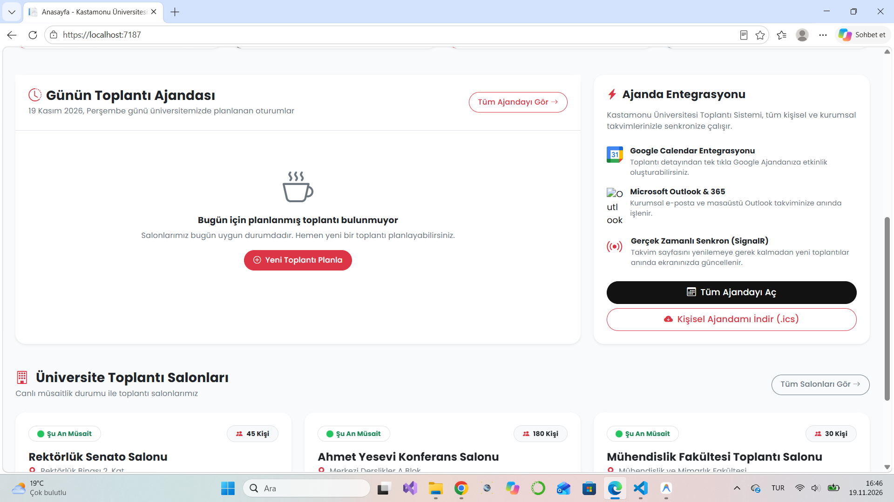
</p>

### 3. Canlı Salon Durum Göstergesi (Pulse Badges)
Her salonda o an toplantı olup olmadığını gösteren canlı nabız göstergesi (`🟢 Şu An Müsait` veya `🔴 Toplantı Sürüyor` ve kalan süre bildirimi).
<p align="center">
  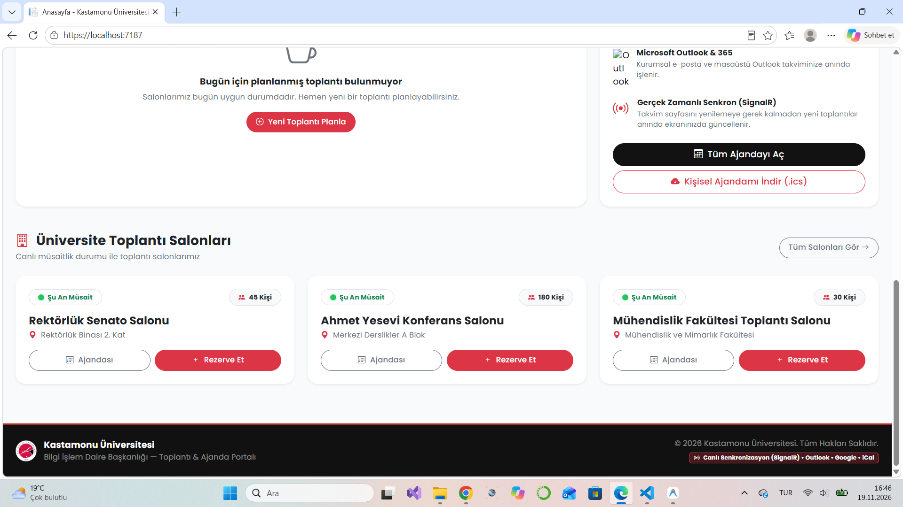
</p>

### 4. İnteraktif Toplantı Takvimi (FullCalendar & SignalR)
Sayfa yenilemeden canlı senkronize olan, salon ve akademik toplantı türüne göre filtrelenebilen, sürükle-bırak destekli ajanda.
<p align="center">
  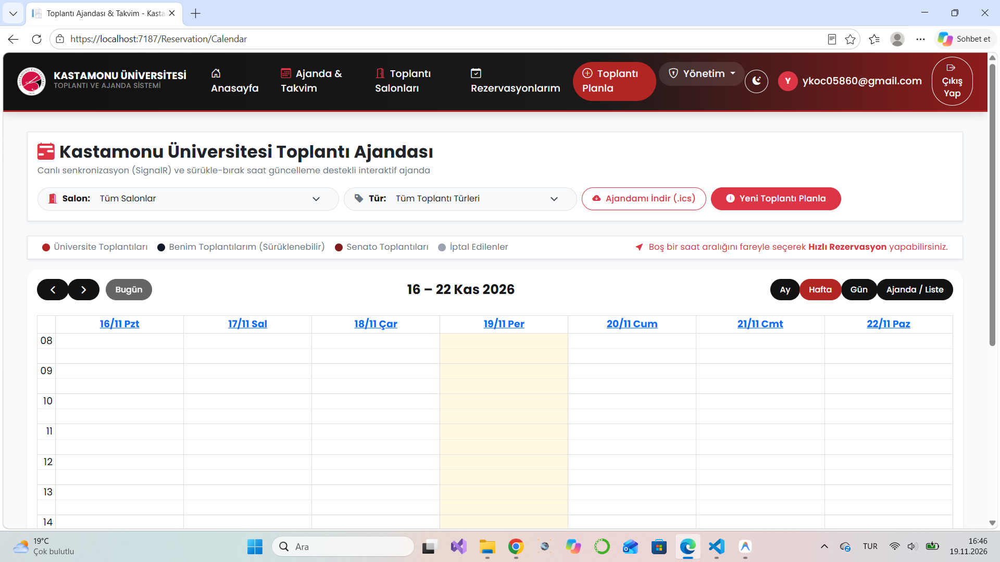
</p>

### 5. Yeni Toplantı Rezervasyon Formu
Akademik toplantı türü seçimi (Senato, Akademik Kurul, Tez Savunması, BAP), katılımcı davet listesi ve gündem açıklamaları girişi.
<p align="center">
  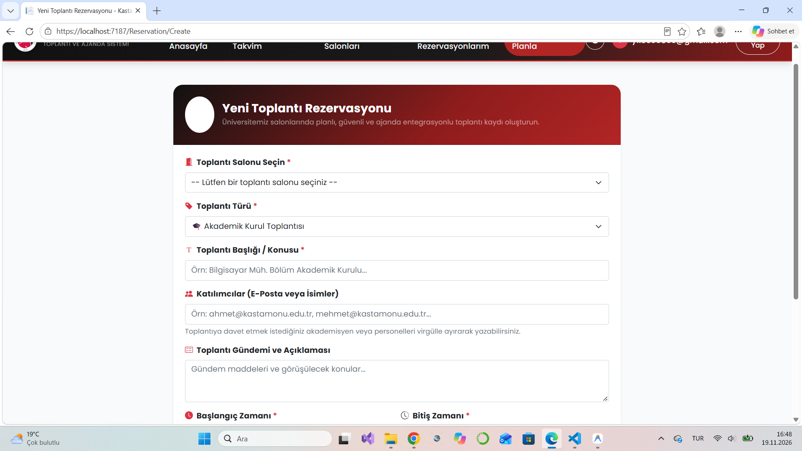
</p>

### 6. Kullanıcı Rezervasyonlarım Listesi & ICS İndirme
Kullanıcının aktif ve geçmiş toplantılarını takip edebildiği, tek tıkla dijital takvim dosyası (.ics) indirebildiği ve detay tutanağına ulaşabildiği yönetim alanı.
<p align="center">
  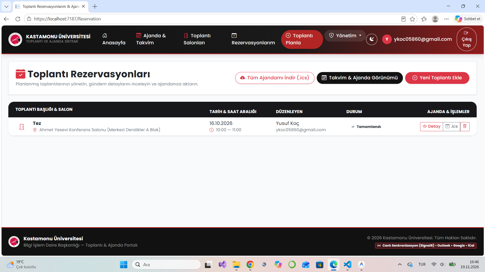
</p>

### 7. Güvenli Giriş, reCAPTCHA & Grafik Güvenlik Kodu (Captcha)
Google reCAPTCHA ve dinamik çizilen güvenlik koduyla brute-force ve bot ataklarına karşı korumalı oturum açma sayfası.
<p align="center">
  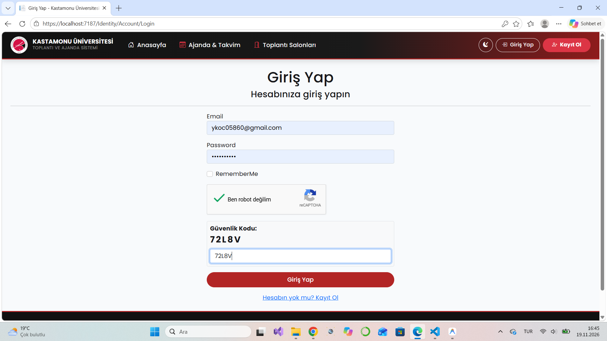
</p>

### 8. Yönetim Paneli — Dashboard & Aylık Rezervasyon Analitiği
Yöneticiler için anlık istatistikler, en çok kullanılan salon sıralaması ve Chart.js destekli aylık rezervasyon trend grafiği.
<p align="center">
  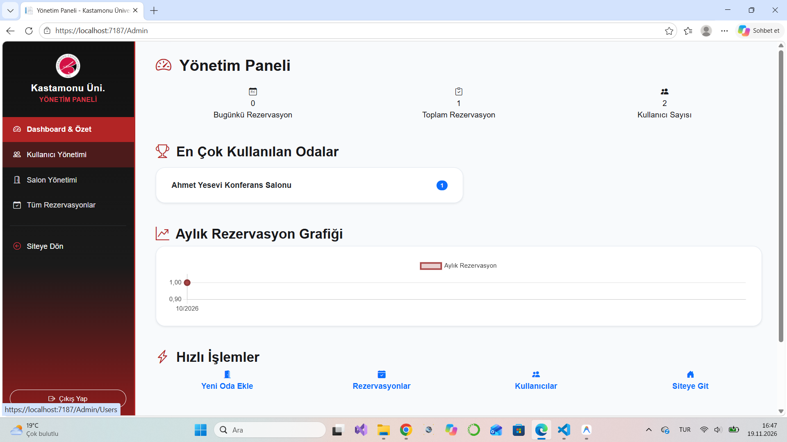
</p>

### 9. Yönetim Paneli — Kullanıcı ve Rol Yönetimi
Sistemdeki kullanıcıları listeleme, detaylarını inceleme ve tek tıkla Admin / User rol ataması yapabilme ekranı.
<p align="center">
  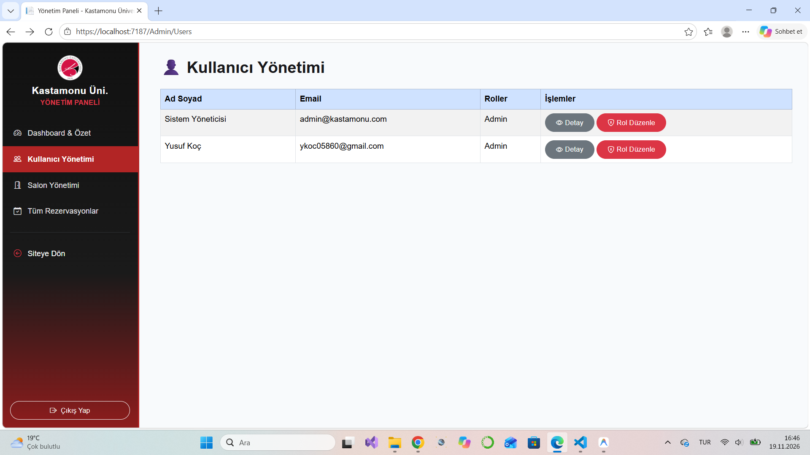
  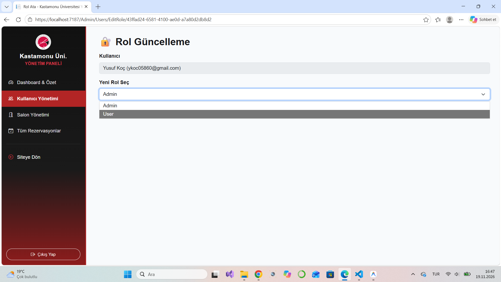
</p>

### 10. Yönetim Paneli — Tüm Rezervasyonların Denetimi
Üniversite genelinde açılan tüm toplantıları onaylama, detaylarını görme, gerektiğinde iptal etme veya silme ekranı.
<p align="center">
  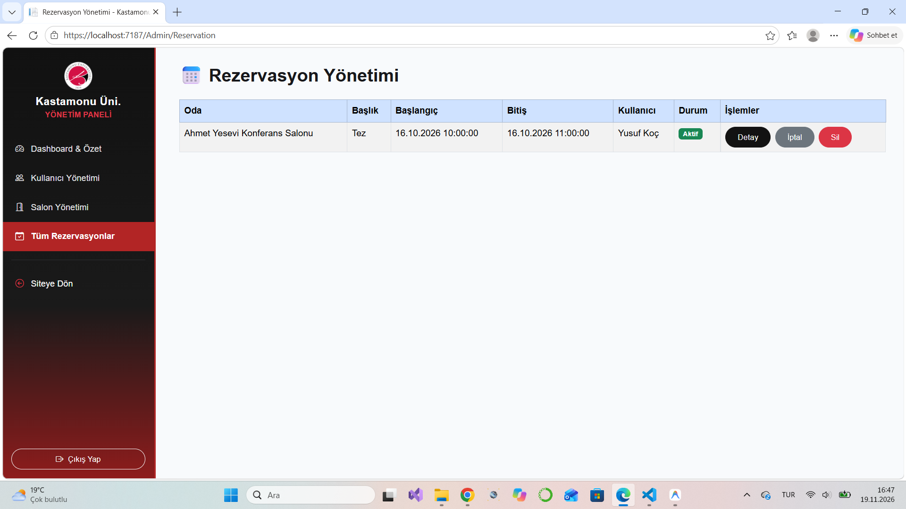
</p>

---

## 🌟 Öne Çıkan Fonksiyonel Özellikler

- **🏛️ Kurumsal Renk Paleti:** Kastamonu Üniversitesi'nin kurumsal kimliği olan `#B22525` Bordo-Kırmızı, `#111111` Siyah ve `#FFFFFF` Beyaz uyumu.
- **🌓 Koyu / Açık Mod (Dark & Light Theme):** Tek tıkla gece moduna geçiş; tercih `localStorage` hafızasında tutulur.
- **🟢 Canlı Salon Durum Rozetleri:** Anlık müsaitlik tespiti, devam eden toplantı adı ve kalan süre sayacı.
- **🔄 SignalR ile Canlı Senkronizasyon:** Farklı bir kullanıcının eklediği veya güncellediği toplantı, açık olan tüm takvimlerde sayfa yenilenmeden anında belirir.
- **🖱️ Sürükle & Bırak ile Saat Güncelleme:** FullCalendar üzerinden toplantı kutusu fareyle sürüklenerek saati değiştirilebilir; çakışma durumunda işlem otomatik geri alınır.
- **⚡ 5 Saniyede Hızlı Rezervasyon:** Takvimde boş bir aralık taranarak sayfa değiştirmeden modal penceresinden hızlı kayıt açılabilir.
- **📺 Salon Kapı Ekranı / Kiosk Tablet Modu (`/Room/DoorDisplay/{id}`):** Salon kapısına asılan tabletler için büyük saat, durum rengi parlaması ve salona özel dinamik QR kod.
- **🎓 Akademik Toplantı Türleri:** Senato Toplantısı, Fakülte/Bölüm Kurulu, Tez Savunması, BAP Toplantısı, Öğrenci Kulübü ve Konferans/Seminer kategorileri.
- **📅 Ajanda & Takvim Entegrasyonu:** Google Calendar, Apple Calendar ve Microsoft Outlook (.ics) tam uyumluluğu.
- **📄 Resmi Tutanak ve Çağrı Çıktısı:** Tek tıkla resmi üniversite formatında katılım yoklama tutanağı yazdırma (`window.print()`).
- **🛡️ Kurumsal Güvenlik:** ASP.NET Core Identity, Cookie güvenliği, Rate Limiting, Google reCAPTCHA ve grafik güvenlik kodu.

---

## 🛠️ Teknoloji Yığını

| Katman | Teknoloji | Açıklama |
| :--- | :--- | :--- |
| **Framework** | .NET 8.0 / C# 12 | Yüksek performanslı LTS kurumsal altyapı |
| **Mimari** | ASP.NET Core MVC | Model-View-Controller + Modüler Yönetim Alanı (Admin) |
| **Gerçek Zamanlı (Real-Time)** | ASP.NET Core SignalR | Çift yönlü WebSocket ile anlık takvim senkronizasyonu |
| **Veritabanı / ORM** | Entity Framework Core 8/9 + MS SQL Server | Code-First, Connection Resiliency & Otomatik Kolon Senkronizasyonu |
| **Kimlik & Yetkilendirme** | ASP.NET Core Identity | Cookie Güvenliği, Şifre Koruması, Rol Yönetimi (Admin / User) |
| **Arayüz (Frontend)** | Bootstrap 5.3 + Custom CSS3 | Üniversite renkleri, CSS Değişkenleri, Koyu Mod |
| **Takvim Kütüphanesi** | FullCalendar v6 | DayGrid, TimeGrid, Etkileşimli Sürükle/Bırak/Seçim |
| **Yardımcı Kütüphaneler** | SweetAlert2, FontAwesome 6, QRious.js, iCal.NET | Bildirimler, vektör ikonlar, dinamik QR ve takvim dışa aktarma |

---

## 📁 Proje Dizin Yapısı

```bash
UniversityMeetingSystem/
│
├── Areas/
│   └── Admin/                     # Yönetici Paneli (Dashboard, Salon & Kullanıcı Yönetimi)
│       ├── Controllers/
│       └── Views/
│
├── Controllers/
│   ├── HomeController.cs          # Canlı durumlar, bugün ajandası ve istatistikler
│   ├── ReservationController.cs   # Rezervasyon, FullCalendar API, SignalR & ICS
│   └── RoomController.cs          # Salon listesi, filtreler, donanımlar ve Kiosk Modu
│
├── Data/
│   └── ApplicationDbContext.cs    # EF Core veri tabanı bağlamı ve tablolar
│
├── Hubs/
│   └── CalendarHub.cs             # Gerçek zamanlı SignalR istemci dağıtım merkezi
│
├── Models/
│   ├── ApplicationUser.cs         # Identity genişletilmiş kullanıcı modeli
│   ├── Reservation.cs             # Toplantı türü, katılımcı ve tarih modeli
│   ├── Room.cs                    # Salon, birim, donanım ve canlı durum modeli
│   └── HomeDashboardViewModel.cs  # Anasayfa özet paneli görünüm modeli
│
├── Services/
│   ├── CalendarIntegrationService.cs  # RFC 5545 iCalendar (.ics) ve Google Calendar servisi
│   └── SmtpEmailSender.cs             # E-posta bildirim servisi
│
├── Views/
│   ├── Home/                      # Anasayfa & Canlı Göstergeler
│   ├── Reservation/               # Takvim, Hızlı Rezervasyon, Tutanak & Detay
│   ├── Room/                      # Salon Kataloğu, Filtreleme ve DoorDisplay (Kiosk)
│   └── Shared/                    # _Layout, Navbar, Dark Mode, SignalR & Footer
│
├── screenshots/                   # Yüksek çözünürlüklü arayüz ekran görüntüleri
├── wwwroot/
│   ├── css/site.css               # Kurumsal Kırmızı-Beyaz-Siyah & Dark Theme stilleri
│   └── js/site.js                 # SignalR dinleyicisi & Dark Mode yöneticisi
│
├── Program.cs                     # Bağımlılık enjeksiyonu, SignalR, Seed Data & Middleware
├── README.md                      # İngilizce dokümantasyon
└── README_TR.md                   # Türkçe dokümantasyon
```

---

## 🚀 Hızlı Kurulum

### Gereksinimler
- [.NET 8.0 SDK](https://dotnet.microsoft.com/download/dotnet/8.0)
- [Microsoft SQL Server](https://www.microsoft.com/sql-server/) (veya SQL Server Express / LocalDB)
- [Visual Studio 2022](https://visualstudio.microsoft.com/) veya [Visual Studio Code](https://code.visualstudio.com/)

### 1. Repoyu Klonlayın
```bash
git clone https://github.com/YusufKoc05/UniversityMeetingSystem.git
cd UniversityMeetingSystem/KastamonuMeetingRoom/KastamonuMeetingRoom
```

### 2. Veritabanı Bağlantısını Yapılandırın
`appsettings.json` dosyasındaki SQL Server bağlantı dizesini (`DefaultConnection`) kendi bilgisayarınıza göre ayarlayın:
```json
"ConnectionStrings": {
  "DefaultConnection": "Server=localhost\\SQLEXPRESS;Database=MeetingRoomDB;Trusted_Connection=True;MultipleActiveResultSets=true;TrustServerCertificate=True"
}
```

### 3. Projeyi Çalıştırın
Uygulama ilk çalıştığında gerekli tabloları otomatik oluşturur, örnek salonları ve varsayılan yönetici hesabını sisteme yükler:
```bash
dotnet run
```
veya Visual Studio / VS Code üzerinden **F5** tuşuna basarak başlatın.

Tarayıcınızdan açın:
- **Web Arayüzü:** `https://localhost:7187` veya `http://localhost:5044`

---

## 🔑 Varsayılan Yönetici (Admin) Girişi

Sistem ayağa kalktığında otomatik tanımlanan yönetici hesabı:
- **E-Posta:** `admin@kastamonu.com`
- **Şifre:** `Admin123!`

---

## 📺 Salon Kapı Ekranı / Kiosk Modu

Her salon için kapı tablet arayüzüne şu URL rotasından doğrudan ulaşılabilir:
```text
https://localhost:7187/Room/DoorDisplay/{SalonID}
```
*Örnek:*
- **Senato Salonu Kiosk:** `/Room/DoorDisplay/1`
- **Ahmet Yesevi Salonu Kiosk:** `/Room/DoorDisplay/2`

> **Özellik:** Kapı ekranındaki dinamik QR kod telefon ile tarandığında, doğrudan o salonun güncel program akışını mobil tarayıcıda açar.

---

## 📄 Lisans
Bu proje [MIT Lisansı](LICENSE) kapsamında lisanslanmıştır. Eğitim ve kurumsal kullanım için serbestçe özelleştirilebilir.

---

## 👨‍💻 Geliştirici & İletişim

**Yusuf Koç**  
- **GitHub:** [@YusufKoc05](https://github.com/YusufKoc05)  
- **Proje Reposu:** [UniversityMeetingSystem](https://github.com/YusufKoc05/UniversityMeetingSystem)

<div align="center">
  <sub>Kastamonu Üniversitesi Bilgi İşlem ve Akademik Birimler İçin Tasarlanmıştır.</sub>
</div>
